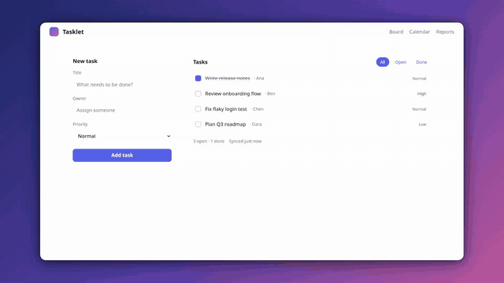
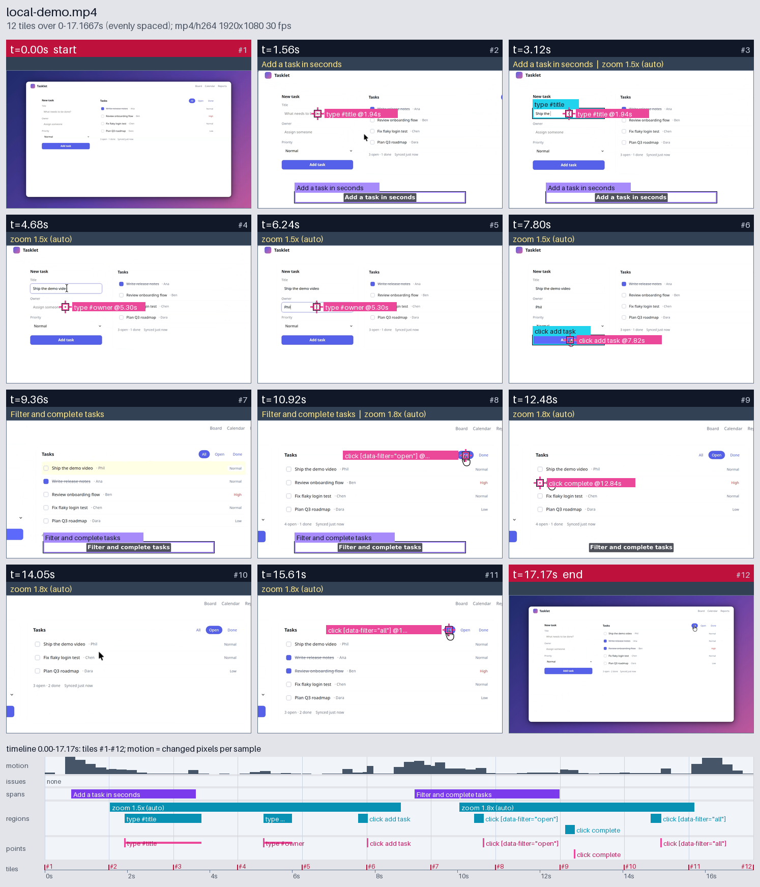

# demoreel

Scripted product demo videos ("videos as code"). Write a short Playwright scenario, and
demoreel records it in headless Chromium, adds a smooth cursor and automatic zoom onto
whatever you click or type into, and renders an MP4 with
[OpenScreen](https://github.com/siddharthvaddem/openscreen)'s own exporter. No screen
recorder, no editing timeline: change the script, run it again.



[MP4 (960px)](docs/assets/local-demo.mp4) · contact sheet with marks (made by
[framesheet](https://github.com/phil65/framesheet) from `marks.json`):



```ts
import { defineScenario } from "@phil65/demoreel";

export default defineScenario({
	name: "add-task",
	serve: "./demo-app", // or skip this and scene.goto("https://your.app")
	viewport: { width: 1920, height: 1080 },
	cssZoom: 1.5,
	async run(scene, { baseUrl }) {
		await scene.goto(`${baseUrl}/`);
		await scene.caption("Add a task in seconds", { duration: 3000 });
		await scene.type("#title", "Ship the demo video");
		await scene.click("#add", { label: "add task" });
		await scene.highlight("#count");
	},
});
```

```bash
npx demoreel run add-task.scenario.ts
# out/add-task/add-task.mp4, .openscreen project, timeline.json, marks.json, contact sheet
```

## Install

```bash
npm install -D @phil65/demoreel playwright
npx playwright install chromium      # Linux CI: npx playwright install --with-deps chromium
# ffmpeg with libx264 on PATH (or DEMOREEL_FFMPEG=/path/to/ffmpeg):
sudo apt install ffmpeg              # macOS: brew install ffmpeg
npx demoreel doctor                  # checks Chromium, ffmpeg, GPU, framesheet
```

- Node >= 20.11 or Bun. TypeScript scenarios run natively on Bun and Node >= 22.18
  (type stripping; erasable syntax only). On older Node install `tsx` or `jiti` next to
  the scenario (demoreel picks them up) or write the scenario as `.mjs`. In a package
  without `"type": "module"`, name TypeScript scenarios `*.mts`.
- `playwright` (or `playwright-core`) is a peer dependency; demoreel uses its Chromium.
- **GPU recommended.** Rendering runs OpenScreen's WebGL (Pixi) + WebCodecs pipeline in
  headless Chromium. demoreel probes for a hardware GL backend (Vulkan / GL on Linux, Metal
  on macOS, D3D11 on Windows) and falls back to SwiftShader with a warning. Rough numbers
  for a 17 s demo: 1080p30 (default) about 77 s on an integrated AMD GPU, 1080p60 about 130 s, 720p30 about 35 s; software
  rendering is 10-20x slower (fine for 640x360 drafts and CI, slow for 1080p).

## CLI

```
demoreel run <scenario.ts|js>     record, write project, render MP4, contact sheet
    --out DIR  --no-render  --fps 30  --quality medium|good|source  --[no-]gpu
    --trim-idle  --speed 1.5  --viewport 1280x720  --headed  -n 12  --framesheet auto|off
demoreel render <project.openscreen> [--out FILE.mp4 --fps --quality --[no-]gpu]
demoreel rezoom <outdir>          re-derive zooms / idle cuts / marks from timeline.json
    --max-depth 4  --lead 350  --hold 800  --no-auto-zoom  --options JSON
    --trim-idle  --idle-options '{"minMs":1500,"keepMs":600,"mode":"speed"}'  --render
demoreel validate <project>       OpenScreen's validateProjectData / normalizeProjectEditor
demoreel sheet <video|outdir>     framesheet inspect --marks marks.json, else ffmpeg tiles
demoreel init [dir] [--url URL] [--js]   scaffold a scenario (+ a demo app to record)
demoreel doctor                   environment check
```

Each run writes into `out/<name>/`:

| file | what |
| --- | --- |
| `<name>.mp4` | the rendered video |
| `<name>.openscreen` | OpenScreen v2 project: open it in the OpenScreen app to tweak by hand, then `demoreel render` |
| `recording.mp4` + `.cursor.json` | raw CFR recording and cursor telemetry (OpenScreen's sidecar format) |
| `timeline.json` | what happened when: actions with target boxes, zoom / trim regions, captions, timings |
| `marks.json` | the same in [framesheet's marks format](https://github.com/phil65/framesheet/blob/main/schema/marks.schema.json), in rendered-video coordinates |
| `framesheet/` or `<name>.sheet.png` | contact sheet for review |

## Scene API

| method | does |
| --- | --- |
| `goto(url)` | navigate (the first call starts the recording) |
| `click(target, { zoom, label, navigates })` | eased cursor travel, aim, click; zooms by default |
| `type(target, text, { clear, zoom })` | click into a field and type with human-ish timing |
| `hover(target, { dwell, zoom })` | move there and rest (no zoom unless asked) |
| `moveTo(target \| {x, y})` | move the cursor, nothing else |
| `scroll(target \| { by: px })` | smooth scroll (the page's or the target's scroll container) |
| `press(key)` | keyboard shortcut, Playwright syntax |
| `pause(ms)` | wait |
| `caption(text, { duration, wait })` | caption overlay (an OpenScreen text annotation, sharp at any zoom) |
| `zoom(target, { depth, duration, context, wait })` | explicit zoom that overrides automatic ones in its window |
| `highlight(target, { duration, color, zoom })` | outline drawn into the page around an element |

`target` is a CSS / Playwright selector or a `Locator`; the first visible match is used and
scrolled into view if needed. `scene.page` is the raw Playwright page.

Scenario options: `viewport`, `cssZoom` (crisper text: lay out at a smaller size and scale
up), `serve` (static dir served at `ctx.baseUrl`), `colorScheme`, `seed`, `pacing`
(`speed`, `beforeAction`, `afterClick`, `typeDelay`, ...), `zoom` (see below), `look`
(`wallpaper`, `padding`, `borderRadius`, `shadowIntensity`, `aspectRatio`,
`captionPosition`), `trimIdle`.

Library: `recordScenario`, `deriveZoomRegions`, `deriveIdleRegions`, `buildProject`,
`buildCursorData`, `buildMarks`, `renderProject`, `validateProject`, `rezoom`,
`reviewSheet`, all typed (`dist/index.d.ts`).

## How cursor and zoom are derived

- **Cursor**: every Scene action moves the real mouse along an eased, slightly arced Bezier
  path (duration from Fitts' law, seeded jitter, so re-runs look the same). Positions are
  sampled at ~60 Hz on the recording clock (CDP screencast frame timestamps) with cursor type
  (arrow / pointer / text from the element's CSS) and click events, and written as OpenScreen
  cursor telemetry. OpenScreen draws the cursor in the export (smoothing, click bounce,
  motion blur), so it stays sharp under zoom.
- **Zoom**: each click / type (and hover with `zoom: true`) records the target's bounding box.
  The depth is the deepest of OpenScreen's six levels (1.25x to 5x) at which the box still
  fits 80% of the view width and 50% of its height (capped by `zoom.maxDepth`, default 3).
  Regions start `leadMs` before the cursor arrives (OpenScreen eases in over ~1.5 s), hold
  `holdMs` after the action, merge with the next action when the union still zooms, and
  otherwise chain so OpenScreen pans instead of zooming out and in. Scrolls and navigation end
  a zoom. The focus is converted to OpenScreen's stage coordinates (padding included) and
  clamped so a zoomed view never shows wallpaper.
- **Anchors**: put `data-demoreel-zoom` on a container to zoom onto the container whenever an
  action targets something inside it (`="2"` forces depth 2, `="off"` disables zoom there).
- **Trim idle** (`trimIdle: true` or `--trim-idle`): stretches with no action, cursor motion,
  caption, zoom transition or visual change are cut to `keepMs` with OpenScreen trim regions
  (or sped up with `mode: "speed"`). `timeline.json` keeps recording times; `marks.json`
  uses output times.
- **Captions** sit at the bottom unless that would cover a target active at the time; then
  they move to the top (`look.captionPosition: "auto"`, or force `"top"` / `"bottom"`).

## Agent loop

`timeline.json` + `marks.json` make the output checkable without watching the video:
`demoreel sheet out/<name>` runs `framesheet inspect <video> --marks marks.json` (framesheet
on PATH, in `node_modules`, or via `uvx framesheet`) which draws clicks, targets, zooms and
captions onto the tiles and flags e.g. captions covering a target. Iterate with
`demoreel rezoom` (no re-recording) and `demoreel render`. A Claude Code skill for this loop
is in [docs/skill.md](docs/skill.md).

## Limitations

- **No HiDPI capture**: Chromium's screencast delivers frames in CSS pixels and ignores
  `deviceScaleFactor`. Use `cssZoom` (pages you control) or a larger viewport for crisp text.
- **Real-time recording**: a scenario takes as long as the video (plus encode and render).
- **GPU recommended** for rendering (see above).
- On Linux the OpenScreen GUI's preview does not show the cursor overlay for imported projects;
  the export (and demoreel's render) does.
- Audio, webcam overlays and multi-tab recordings are not supported.

## License

MIT. The prebuilt renderer bundles unmodified [OpenScreen](https://github.com/siddharthvaddem/openscreen)
code (MIT) and npm packages listed in [THIRD_PARTY_NOTICES.md](THIRD_PARTY_NOTICES.md)
(licence texts in `licenses/`).
